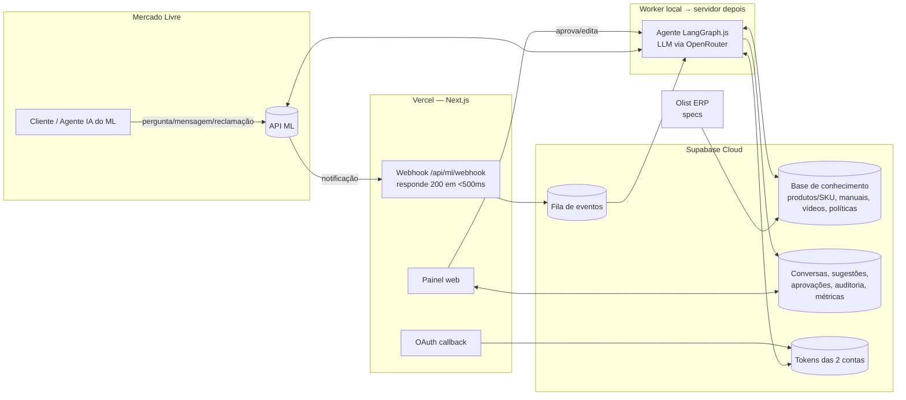
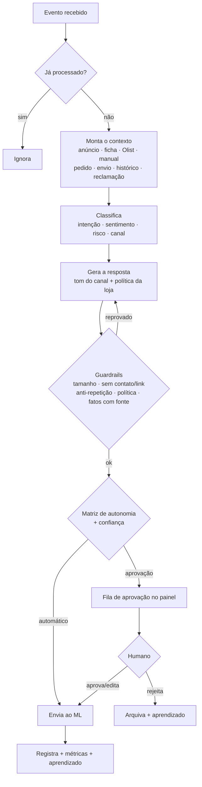
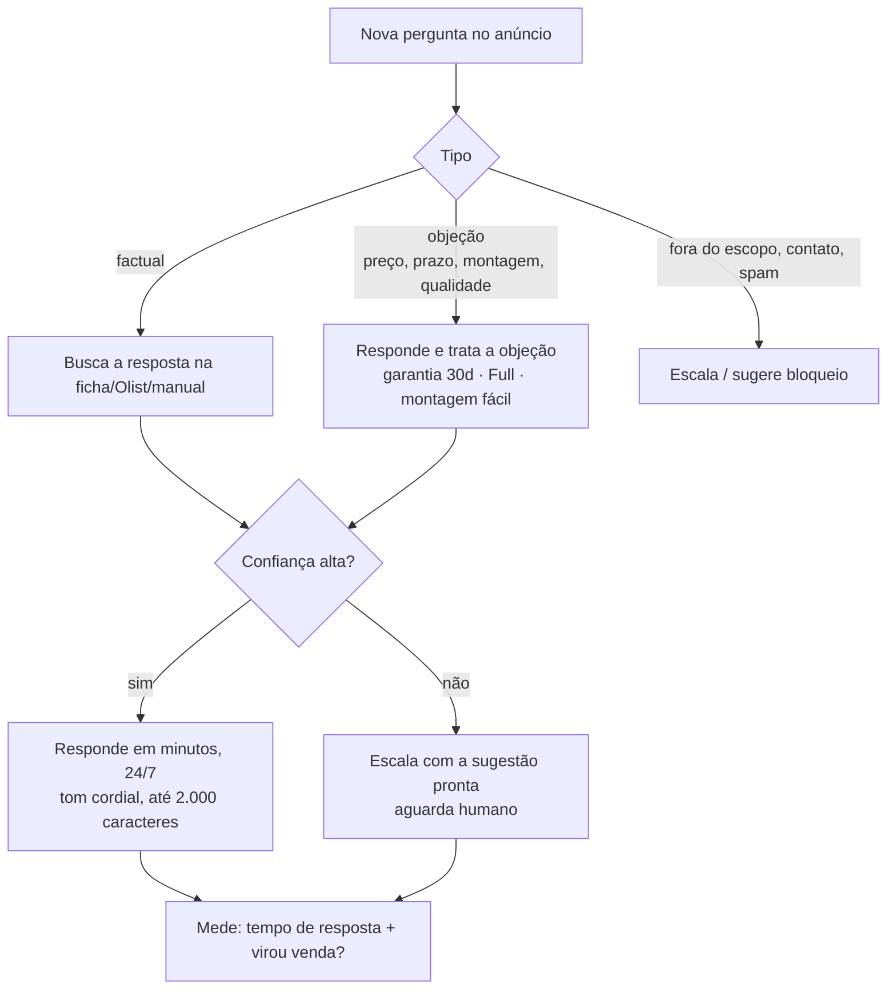
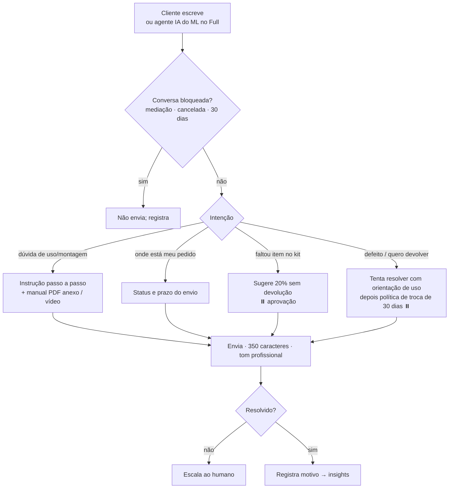
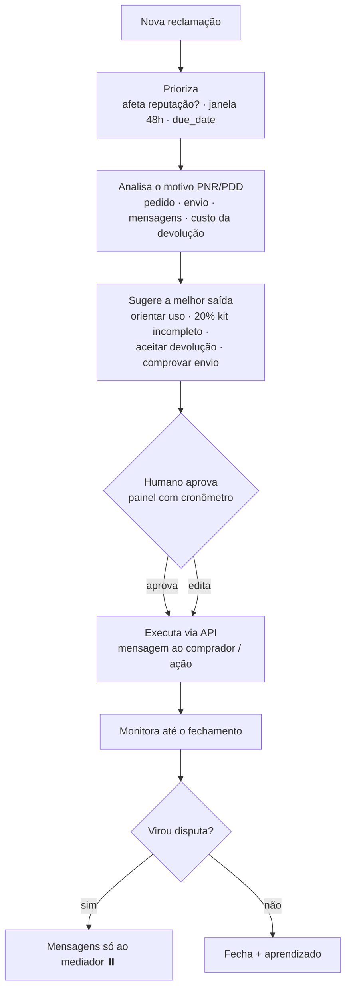
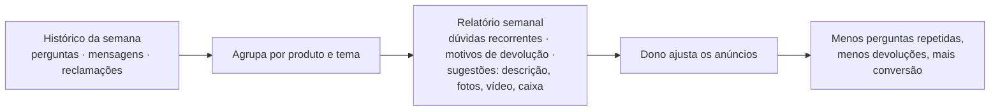

# Agente de IA de Atendimento — Mercado Livre
**Documento de contexto e desenho da solução (para validação com o mentorado)** · v1 · 16/10/2026

> **Entrega imediata após aprovar este plano:** publicar este documento como uma **página visual privada e compartilhável**, com fluxogramas desenhados (diagrama geral + um fluxo por tipo de atendimento), cards de decisões e uma matriz de autonomia. Ela serve para o mentor validar com o mentorado. **Nenhum código do agente** é escrito antes da validação. Os mesmos textos também ficam em `C:\Users\tocub\pinese\docs\` (fonte versionável).

---

## 1. Contexto do negócio
- **Operação**: 2 contas de vendedor no Mercado Livre, com catálogo **parcialmente igual**. São ~40 anúncios ativos e mais ~40 a publicar. Loja: *mercado_mestre*.
- **Nicho**: Casa · Jardim e ar livre · Decoração · Ferramentas.
- **Volume**: até ~50 perguntas e mensagens por dia.
- **Equipe**: o dono e mais 1 pessoa, só em horário comercial. Noite e fim de semana ficam sem cobertura.
- **Logística**: **Full** (Fulfillment) e **Mercado Envios coleta/agência**.
- **ERP**: **Olist**, que guarda as especificações dos produtos.
- **Futuro**: outras contas do ML e outros marketplaces. O agente nasce preparado para isso.

### Dores atuais
1. Demora para responder fora do horário, o que faz a venda ir para o concorrente.
2. Perguntas repetitivas: medidas, material, o que acompanha, prazo.
3. Reclamações e mediações que afetam a reputação.
4. Devoluções altas, principalmente por **arrependimento/atraso** e por **dificuldade de montagem/uso**.

### Objetivos do agente
| Objetivo | Como o agente ataca |
|---|---|
| **Responder 24/7 e rápido** | Responde sozinho as perguntas factuais em minutos e escala o resto com a sugestão pronta. |
| **Aumentar a conversão** | Responde com precisão e trata objeções ativamente: garantia de 30 dias, entrega Full, facilidade de montagem. |
| **Diminuir as devoluções** | Na pré-venda, deixa clara a expectativa (medidas, montagem). No pós-venda, ajuda o cliente a usar e montar o produto, com manual PDF e vídeo. |
| **Proteger a reputação** | Prioriza as reclamações pela janela de 48h e pelos prazos do ML, e sugere a melhor saída. |
| **Melhorar os anúncios** | Gera um relatório semanal com dúvidas recorrentes, motivos de reclamação e sugestões de ajuste no anúncio. |

### KPIs de sucesso
- Tempo de resposta a perguntas **abaixo de 10 min**, 24/7. A medição usa o endpoint oficial `response_time` do ML.
- Taxa de reclamação e reputação **verde ou MercadoLíder**. A meta é que as reclamações sejam resolvidas na janela de 48h.
- **Taxa de devolução** em queda, com atenção especial a montagem/uso e arrependimento.
- **Conversão pergunta → venda**: quantos compradores que perguntaram compraram depois.
- Indicadores de apoio: percentual respondido automaticamente, percentual aprovado sem edição e mensagens moderadas pelo ML (meta zero).

---

## 2. Regras de negócio e políticas da loja
- **Garantia de vendedor**: 30 dias.
- **Troca e devolução**: 30 dias.
- **Peça de reposição**: **nunca** é enviada, para nenhum SKU. O agente nunca promete peça.
- **Kit com item faltando**: o agente propõe **20% de desconto sem devolução** (payback). A proposta **sempre passa pela aprovação humana**.
- **Alçada financeira do agente**: **zero**. Ele só sugere reembolso, devolução ou desconto. Quem aprova é o humano.
- **Tom de voz**:
  - Pré-venda (perguntas): próximo, humanizado e cordial.
  - Pós-venda e reclamações: profissional e objetivo.
- **Incerteza**: se a confiança é baixa, o agente **escala e aguarda o humano**. Uma pergunta no ML aceita só 1 resposta e ela não pode ser editada, então é melhor esperar do que errar.

### Matriz de autonomia (modo híbrido)
| Situação | Agente responde sozinho? | Observação |
|---|---|---|
| Pergunta pré-venda factual com alta confiança (medidas, material, cor, o que acompanha, compatibilidade) | ✅ Sim | Baseada só em anúncio, ficha, Olist e manual |
| Pergunta com baixa confiança, informação ausente ou tema sensível | ⏸️ Escala | O humano recebe a sugestão pronta no painel |
| Pós-venda: dúvida de uso ou montagem | ✅ Sim | Pode anexar o manual PDF |
| Pós-venda: status do envio ou da entrega | ✅ Sim | Dados de `/shipments` |
| Pós-venda: "veio faltando", "quebrou", "quero devolver" | ⏸️ Aprovação | A sugestão segue a política (ex.: 20% kit incompleto) |
| Reclamação ou mediação (qualquer) | ⏸️ Aprovação | Prioridade pela janela de 48h e pelo `due_date` |
| Reembolso, devolução, desconto ou abertura de disputa | ⏸️ Sempre humano | Alçada zero |
| Cliente agressivo, ameaça (Procon, Reclame Aqui) ou spam | ⏸️ Escala | Opção de bloquear o perguntador |

A autonomia é **configurável por categoria** no painel e pode ser ampliada conforme a confiança aumenta.

---

## 3. Regras do Mercado Livre que moldam o agente
Pesquisa na documentação oficial, feita em 14/10/2026.

**Perguntas (pré-venda)**
- Resposta com no máximo 2.000 caracteres. **Só se responde uma vez, sem editar.** O anúncio precisa estar ativo.
- Proibido passar dados de contato, links externos ou redes sociais. O ML modera e pode banir.
- O tempo de resposta conta para a exposição e a conversão. Depois de 1h, ele "afeta seu tempo de resposta". O próprio ML recomenda um modo **semiautomático**, com sugestão e revisão humana.

**Mensagens (pós-venda)**
- O vendedor tem **350 caracteres** por mensagem e pode anexar PDF, JPG, PNG ou TXT de até 25 MB.
- O **vendedor não inicia a conversa**. A exceção é o "motivo de contato" (`action_guide`), que tem cota de cerca de 1 uso e não está disponível depois da entrega.
- **Mensagens automáticas, repetitivas ou com cara de template são proibidas** e podem levar à moderação ou à suspensão da conta. O agente precisa variar o texto e só escrever quando houver necessidade.
- Vendas **Full**:
  - A mensageria fica bloqueada até a entrega.
  - **Desde 02/02/2026, um agente de IA do próprio ML intermedia o pós-venda Full.** O nosso agente conversa com ele, uma mensagem por vez, e tem 48h úteis para resolver.
- A conversa é bloqueada com mediação aberta, venda cancelada, reembolso ou depois de 30 dias sem mensagem.

**Reclamações**
- Tipos de motivo: **PNR** (não recebido), **PDD** (diferente ou defeituoso) e **CS** (cancelamento).
- **Janela de ouro**: quando `has_incentive` está ativo, resolver bem nas **primeiras 48h faz a reclamação não afetar a reputação**.
- Cada ação tem prazo (`due_date`). Quando vira **disputa**, só é possível falar com o mediador do ML.
- O reembolso parcial via API só aceita os percentuais oferecidos pelo ML. **Os 20% podem não estar disponíveis**, o que é um ponto a validar.

**Infraestrutura**
- Webhook: precisa responder em até 500 ms. As retentativas duram 1h e o histórico de notificações perdidas guarda só 2 dias.
- OAuth: o token vale 6h. O refresh token é **de uso único** e vale 6 meses.
- O Brasil permite **1 app por titular**, e quem autoriza precisa ser o **admin** de cada conta. Não há sandbox; os testes usam usuários de teste.

**Concorrência**
- Nativos do ML: a "resposta sugerida" por IA e o assistente de pós-venda.
- Terceiros: GoBots (a partir de R$ 699/mês), Predize, Real Trends e outros.
- **Diferencial do nosso agente**:
  - reclamações orientadas a prazo e reputação;
  - suporte de uso com os manuais e vídeos do próprio vendedor;
  - insights para os anúncios;
  - o dono no controle, com uma política escrita por ele.

---

## 4. Desenho do agente — fluxogramas

### 4.1 Visão geral (arquitetura)

### 4.2 Cérebro do agente (pipeline comum a todo atendimento)

### 4.3 Fluxo de pergunta pré-venda (conversão)

### 4.4 Fluxo pós-venda (uso, montagem e redução de devolução)

### 4.5 Fluxo de reclamação (proteção da reputação)

### 4.6 Ciclo de insights semanal

---

## 5. Arquitetura técnica (resumo)
- **Front + webhooks + OAuth**: Next.js na **Vercel**.
- **Banco**: **Supabase Cloud**, com Postgres, Auth, RLS e pgvector para a busca semântica na base de conhecimento.
- **Agente**: **LangGraph.js (TypeScript)**. Roda **localmente** na fase de testes e vai para servidor próprio antes da operação 24/7 em produção.
- **LLM**: via **OpenRouter**, para poder trocar de modelo.
- **Monorepo TypeScript**, com tipos e schemas Zod compartilhados entre o painel e o agente.
- **Canal Mercado Livre isolado** numa camada própria, para plugar outros marketplaces depois.
- **Resiliência**:
  - fila idempotente;
  - reconciliação periódica: perguntas sem resposta, mensagens não lidas e reclamações abertas;
  - renovação de token centralizada, com trava por conta.
- **WhatsApp**: numa fase posterior, via Evolution API no servidor próprio, para alertas e aprovação rápida.

## 6. Módulos do painel (vão para o protótipo HTML)
1. **Caixa de entrada unificada**: perguntas, mensagens e reclamações; filtro por conta e status; SLA.
2. **Detalhe e aprovação**: contexto completo, sugestão com nível de confiança e justificativa, editar, aprovar ou rejeitar, alertas de guardrail.
3. **Reclamações**: linha do tempo, cronômetro da janela de 48h e ações sugeridas com custo comparado.
4. **Base de conhecimento**: produto/SKU ligado aos anúncios das 2 contas, manuais, vídeos, FAQ aprendida e políticas.
5. **Configurações do agente**: autonomia por categoria, tom por canal, horário e contas conectadas.
6. **Dashboard e insights**: KPIs e o relatório semanal.

## 7. Roadmap (fluxo padrão de desenvolvimento)
1. **Contexto**: este documento. ⬅️ *estamos aqui*
2. **Protótipo HTML** do painel, módulo a módulo, validado pelo cliente.
3. **Roadmap e tarefas** depois da validação.
4. **Estrutura de dados** no Supabase.
5. **Codebase modular**, front e agente juntos, módulo a módulo. O piloto começa em **modo 100% aprovação** por 1 a 2 semanas para calibrar, depois a autonomia é liberada conforme a matriz.

## 8. Perguntas em aberto (para validar com o mentorado)
1. App no DevCenter do ML: quem é o titular (CNPJ?) e se o admin das 2 contas é a mesma pessoa.
2. Olist: há acesso à API? Quais campos de especificação existem?
3. Horário comercial exato e quem aprova (dono e/ou assistente, com perfis diferentes?).
4. Cobertura da garantia de 30 dias: o que conta como defeito e o que é mau uso.
5. Os 20% do kit incompleto: usar o percentual mais próximo que o ML oferece ou estornar via Mercado Pago?
6. Material **dentro da caixa** (manual impresso, QR para vídeo) para combater montagem/uso no Full, onde não dá para mandar mensagem antes da entrega.
7. Lista dos produtos com montagem mais complexa, para priorizar na base de conhecimento.

---

## Execução após aprovar este plano
1. Rodar `Artifact quickstart` com a intenção adequada, carregar o design de página e montar **uma página HTML visual**. Ela terá: capa, contexto e dores, objetivos e KPIs, políticas, matriz de autonomia, regras do ML (cards), os **6 fluxogramas** desenhados com visual caprichado (SVG/HTML, claro e escuro, legível no celular), arquitetura, módulos, roadmap e perguntas em aberto.
2. Publicar como Artifact **privado** e entregar o link para compartilhar com o mentorado.
3. Salvar a versão em Markdown em `C:\Users\tocub\pinese\docs\01-documento-do-agente.md`.
4. **Parar e aguardar a validação.** O protótipo do painel e o agente só começam depois do retorno do mentorado.

### Verificação
- Abrir a página publicada: fluxogramas legíveis no desktop e no celular, sem rolagem horizontal, tema claro e escuro funcionando.
- Conferir se todas as decisões da conversa estão refletidas no documento.
